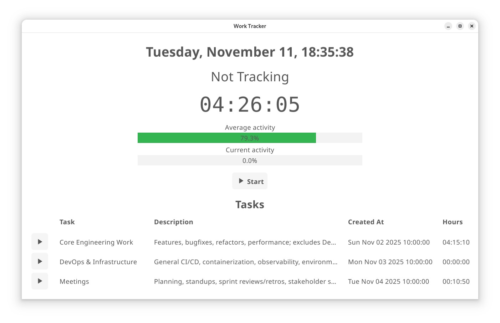
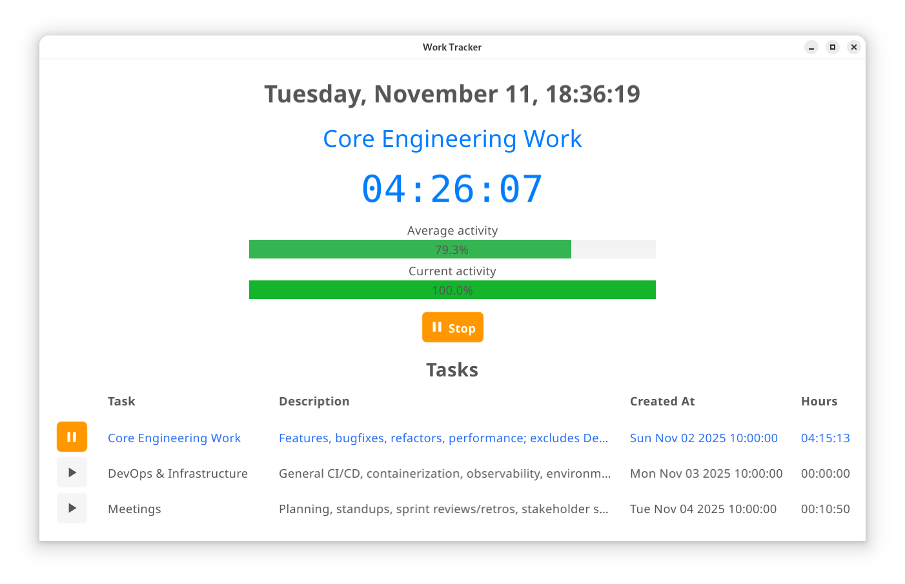
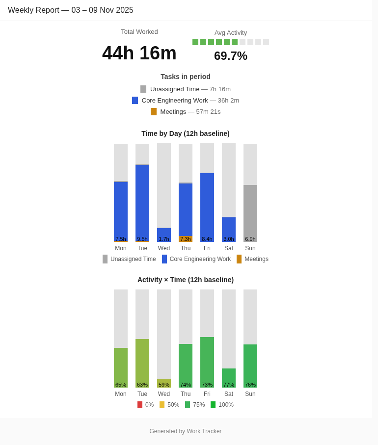
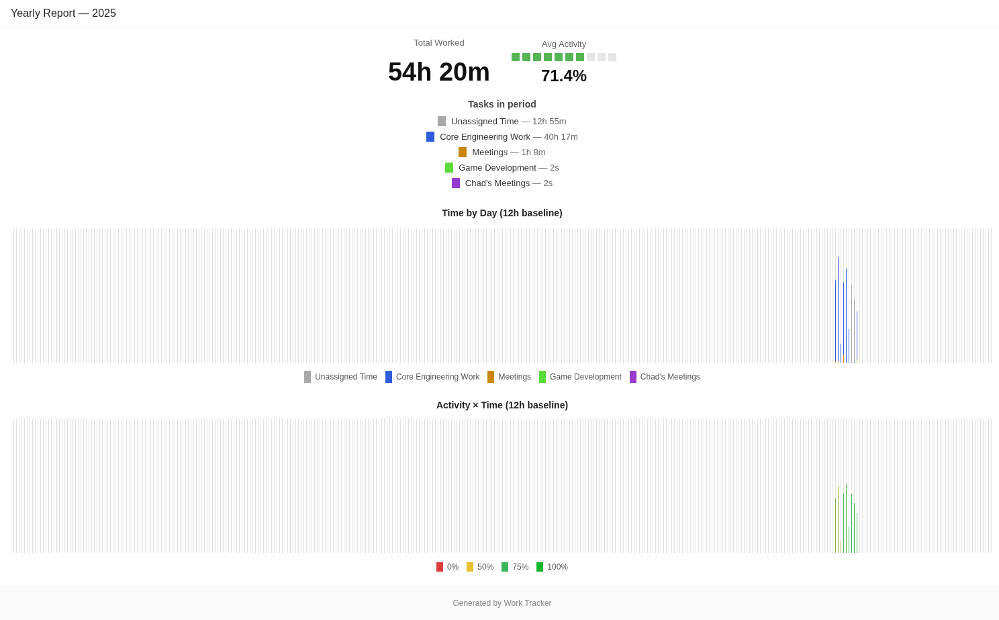
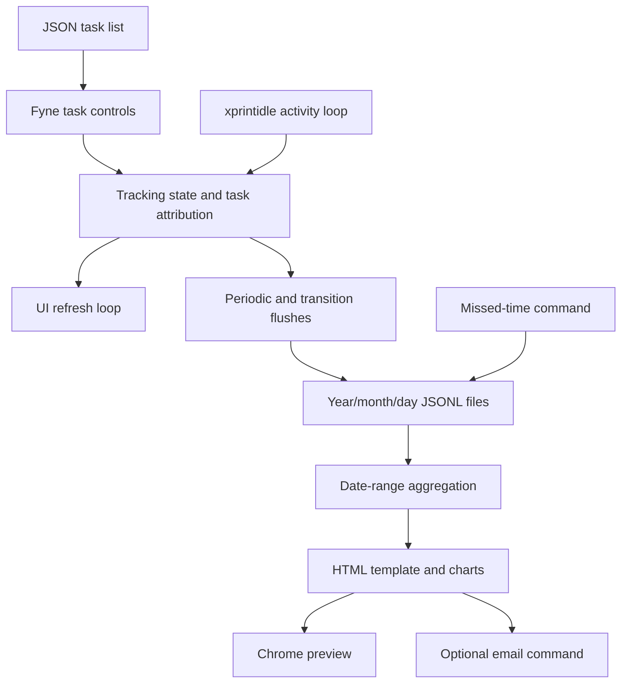

# Work Tracker

A personal Go desktop application for tracking time by task and generating HTML reports. Time records stay in local JSONL files; reports can optionally be emailed through Mailgun, SendGrid, or Amazon SES.

## Features

- Start and stop tracking, switch tasks, and view daily task totals.
- Estimate current and average input activity using `xprintidle`.
- Show, hide, and quit the desktop window from the system tray when supported.
- Generate reports for selected date ranges with task totals and daily time/activity charts.
- Append missed time using a separate command.

## Screenshots

### Desktop application

The desktop interface while idle, with daily totals and task controls:



While tracking, the current task is highlighted and activity meters update:



### Weekly report

Task totals, stacked daily time bars, and activity-weighted time for a week:



### Yearly report

A full-year view with compact daily bars:



## Architecture



## Setup

The included installation instructions target Debian/Ubuntu. Use the Go version declared in `go.mod` (currently 1.26.7), a graphical desktop, `xprintidle`, and the OpenGL/X11 build libraries listed in [INSTALL.md](./INSTALL.md). Activity detection relies on X11; Wayland behavior depends on the desktop/session and is not established here.

From the repository root, after installing prerequisites:

```sh
cp cfg/example.config.json cfg/config.json
cp cfg/example.tasks.json cfg/tasks.json
bash scripts/install.sh
```

The install script builds `tracker`, `report`, `send-email`, and `cheat` into `build/` and installs desktop launchers into the user's applications directory. Edit `cfg/tasks.json` for your task list; `cfg/config.json` configures logging.

```sh
./build/tracker
./build/report --start 01-09-2026 --end 30-09-2026 --tz America/Chicago
```

Run commands from the project root so templates and image assets can be found. The report defaults to the current Monday–Sunday week in `America/Bogota`; pass `--tz` explicitly for another timezone. It writes `out/report.html` and then starts `google-chrome`. File generation can succeed even if browser launching fails.

Records use paths such as `out/2026/september/28_september_2026.jsonl`. Restart the tracker at a day boundary: automatic daily rollover is not implemented. Input activity records whether input occurred during a sampling interval, not continuous attention; failed idle detection currently counts as activity.

### Add missed time

Pause tracking before appending to avoid overlapping records:

```sh
./build/cheat --after 15 --minutes 60 --activity 75
./build/cheat --date 2026-09-28 --minutes 30 --activity 80 --task "Game Development"
```

The first command starts 15 minutes after the last record, adds 60 elapsed minutes and 45 active minutes, and inherits its task. The date defaults to today, activity to 100, and gap to zero. An existing nonempty day file is required; malformed records and additions outside the selected day are rejected. The previous record's timezone offset is preserved. `--work-dir` defaults to `./out`; `--config` selects the logger configuration used by the other commands.

You can also run or build the missed-time command directly from source:

```sh
go run ./src/cmd/cheat --after 15 --minutes 60 --activity 75
go run ./src/cmd/cheat --date 2026-09-28 --after 1 --minutes 130 --activity 80 --task "Other Pet Projects"
go run ./src/cmd/cheat --after 1 --minutes 130 --activity 80 --task "Other Pet Projects"
go build -o ./build/cheat ./src/cmd/cheat
```

### Optional email delivery

The desktop wrappers in `scripts/` source `env/.env.sh`, which is not created by the install script. To use those wrappers, create it from `env/.example.env.sh` and create `env/.mail.env.sh` from `env/.example.mail.env.sh`. Direct local tracker/report commands do not require these shell files.

Before invoking `send-email`, export the variables named in the mail example. The current CLI checks all provider variables even when only one provider is selected; its source permits dummy values for unused providers. Configure real credentials for the selected service and keep them out of Git.

```sh
./build/send-email report --provider mailgun --sender SENDER --recipient RECIPIENT --html-file ./out/report.html
```

Replace `SENDER` and `RECIPIENT` with your addresses. See [email command documentation](./src/cmd/send-email/README.md) for the provider-test subcommand.

## Tests and status

```sh
go test ./src/pkg/cheat
```

The available tests cover append behavior, newline handling, task inheritance/override, and rejected inputs preserving the file. They do not cover desktop timing or email delivery and were not run during repository analysis.

The main implementation period was October–November 2025, followed by occasional maintenance and feature updates through September 2026.

## License

MIT; see [LICENSE](./LICENSE).
