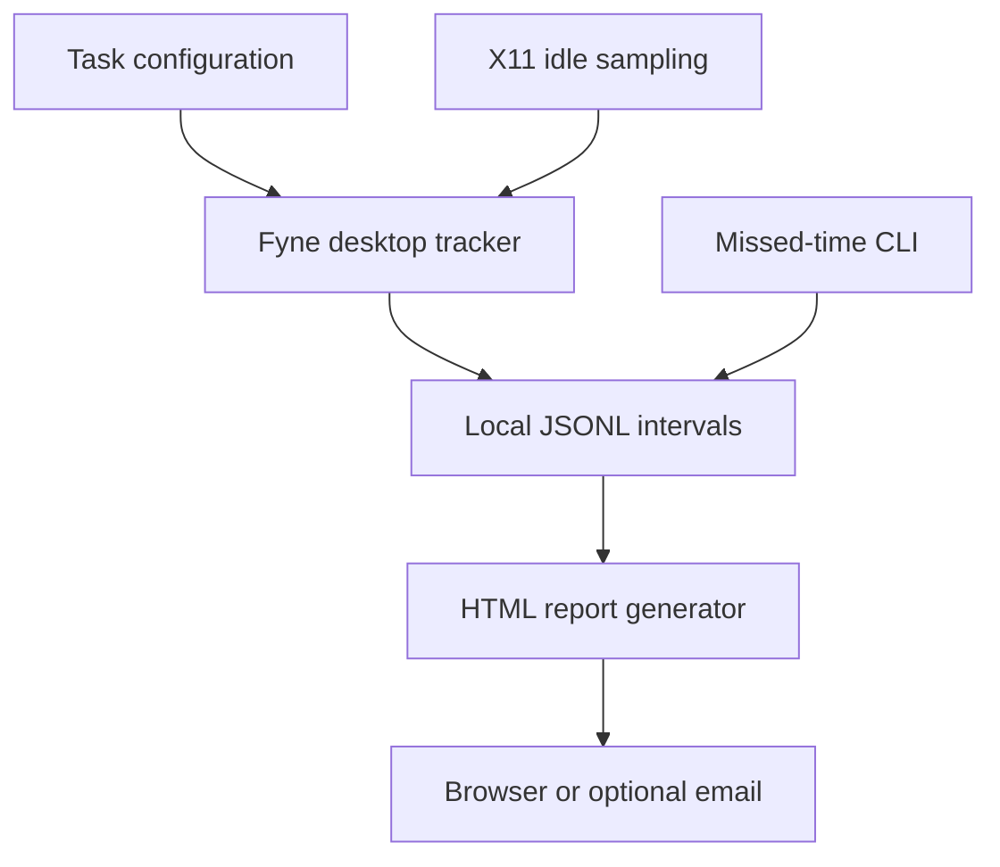

# Work Tracker

## Overview

Work Tracker is a personal desktop application for recording time against tasks and reviewing work patterns. It stores time intervals locally as JSONL and generates HTML reports over selected dates. Email delivery is optional.

## My Contributions

The repository demonstrates implementation of a Fyne desktop interface with task switching, daily totals, activity bars, and system tray controls; separate loops for UI refresh, activity sampling, and periodic persistence; a date-range report generator; and command-line tools for email delivery and adding missed time. Fyne, provider SDKs, logging, and error libraries supply supporting functionality.

## Architecture

The tracker records elapsed time separately from an estimate of input activity. Each sampling interval is considered fully active if input occurred during it. Records contain task names, start and finish timestamps, and active duration. Reports aggregate those records into task totals, stacked daily time bars, and activity-weighted time charts.

## Technical Challenges

Task transitions must preserve attribution: the tracker updates elapsed and activity counters and flushes the old interval before changing tasks. UI, activity, and save timers operate independently, with mutex-protected state and Fyne UI dispatch. Reporting adapts bar widths and labels for longer date ranges and uses a shared task-color mapping for chart segments and legends.

The missed-time command validates arguments and day boundaries, preserves the previous record's timezone offset, and handles files without a final newline. Its tests cover successful appends and rejection without modifying existing data.

## Results and Current State

The repository contains the desktop application, installation scripts, report templates, screenshots, optional Mailgun/SendGrid/SES integrations, and tests for missed-time insertion. Source inspection establishes implemented behavior; GUI operation, provider delivery, and tests were not executed for this analysis. Input activity is a heuristic rather than a measure of productivity. The current tracker needs restarting at a day boundary to keep records assigned to the correct daily file.

### Desktop application

The desktop interface while idle, with daily totals and task controls:

While tracking, the current task is highlighted and activity meters update:

### Weekly report

Task totals, stacked daily time bars, and activity-weighted time for a week:

### Yearly report

A full-year view with compact daily bars:

## Development History

Observed Git activity runs from October 30, 2025 to September 30, 2026. The main implementation period is inferred as October 30–November 11, 2025: 132 of 152 commits introduced tracking, task attribution, reporting, email support, and desktop installation. January–February 2026 brought report-template extraction, year/month storage directories, and tray integration. September 2026 added maintenance changes, malformed-JSON recovery, missed-time insertion, and consistent report colors. This supports a mature personal utility receiving occasional updates; it does not establish the actual project start date or a formal completion date.
